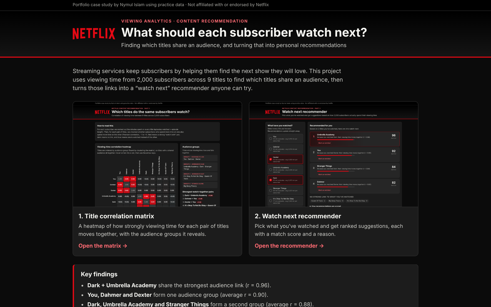
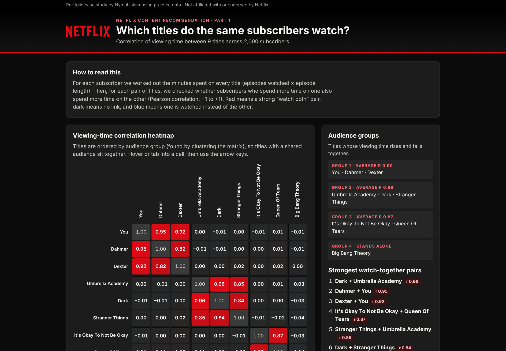
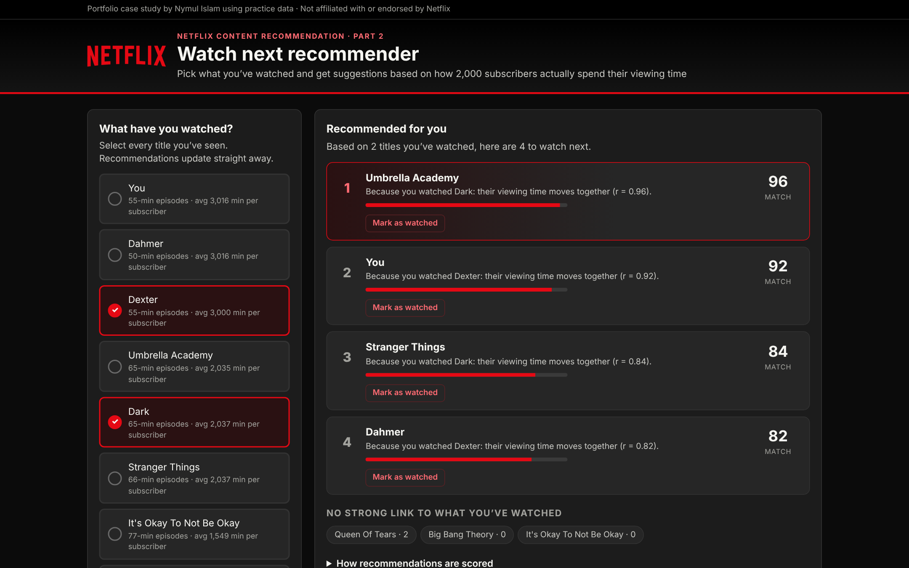

# Netflix Content Recommendation

What should each subscriber watch next? This project finds which titles share an audience, using 2,000 subscribers' viewing time, and turns those links into an interactive "watch next" recommender.

**🔗 Live project: https://nymul-seam.github.io/netflix-content-recommendation-/**

- [Title correlation matrix](https://nymul-seam.github.io/netflix-content-recommendation/correlation-matrix.html)
- [Watch next recommender](https://nymul-seam.github.io/netflix-content-recommendation/recommender.html)

[](https://nymul-seam.github.io/netflix-content-recommendation/)

> Portfolio case study using practice data. It is not affiliated with or endorsed by Netflix.

---

## Business problem

A streaming service keeps subscribers when they keep finding something they want to watch. If a viewer finishes a show and the next suggestion misses, they browse, get frustrated, and may cancel. The service needs to know which titles are watched by the same people, and use that to suggest a relevant next title with a clear reason.

## Key findings

| Audience group | Titles | Average r |
|---|---|---|
| Group 1 | You · Dahmer · Dexter | 0.90 |
| Group 2 | Umbrella Academy · Dark · Stranger Things | 0.88 |
| Group 3 | It's Okay To Not Be Okay · Queen Of Tears | 0.87 |
| Stands alone | Big Bang Theory | — |

- The strongest single link is **Dark + Umbrella Academy** (r = 0.96).
- Links between groups are close to zero. Each group is a separate audience, so cross-group suggestions would likely miss.
- **Big Bang Theory** has the most viewing time per subscriber (about 3,025 minutes) but no audience link to any other title. It needs a different way in, such as a popularity or "new to you" row.

## Deliverable 1: Title correlation matrix

[](https://nymul-seam.github.io/netflix-content-recommendation/correlation-matrix.html)

- A 9 × 9 heatmap ordered by audience group, not alphabetically.
- A diverging colour scale: red means watched together, dark means no link, blue means watched instead. The value is printed in every cell.
- Hover or tab into a cell, then use the arrow keys, to read what each value means.
- Shows the audience groups, the strongest pairs and the average viewing time per subscriber.

## Deliverable 2: Watch next recommender

[](https://nymul-seam.github.io/netflix-content-recommendation/recommender.html)

- Select the titles you've watched. Recommendations update straight away.
- Each suggestion shows a **match score** (0 to 100) and a reason, for example "Because you watched Dark: their viewing time moves together (r = 0.96)".
- **Mark as watched** adds a title to your list and refreshes the suggestions.
- Titles with no strong link are listed separately rather than recommended.

## Method

- **Minutes watched** = episodes watched × episode length, for each subscriber and title: 2,000 subscribers × 9 titles = 18,000 rows.
- **Correlation:** Pearson's r of minutes watched between every pair of titles, across all subscribers.
- **Audience groups:** average-linkage agglomerative clustering on the correlation matrix. Groups merge while their average correlation is at least 0.40.
- **Match score:** the strongest correlation between a candidate title and any title you've watched, × 100 (0 if negative). Titles scoring 30 or more are recommended, highest first. Ties go to the title with more average viewing time.
- This is **item-to-item collaborative filtering**: it uses viewing behaviour only.

## Assumptions

- "Episodes watched" has decimals, so it is treated as episode-equivalents (a partly watched episode counts as a fraction).
- The data has no genre, rating or date fields, so groups are based on viewing behaviour only and no genre labels are added.
- The data had no blanks or duplicates, and every subscriber has a row for every title.

## Tools

HTML, CSS and vanilla JavaScript (no libraries or frameworks) · Excel (pivot and correlation check) · Python and pandas (data check) · AI-assisted development with Claude · GitHub Pages (hosting)

Each HTML file is self-contained: the data and all the code are built in, with no external calls. Each one works on GitHub Pages or when opened straight from your computer, on phones, and with a keyboard.

## Repository structure

```
netflix-content-recommendation/
├── index.html                          # project home page linking both tools
├── correlation-matrix.html             # Deliverable 1
├── recommender.html                    # Deliverable 2
├── README.md                           # this file
├── screenshot.png                      # home page preview
├── screenshot-matrix.png               # matrix preview
├── screenshot-recommender.png          # recommender preview
├── netflix_viewing_raw_with_minutes.csv  # raw rows plus the minutes-watched column
└── netflix_minutes_by_subscriber.csv     # one row per subscriber, minutes per title (the matrix input)
```

## Author

**Nymul Islam**, Operations Data Analyst, The Data & AI Institute · Hobart, Tasmania

- LinkedIn: https://www.linkedin.com/in/md-nymul-islam
- GitHub: https://github.com/nymul-seam
